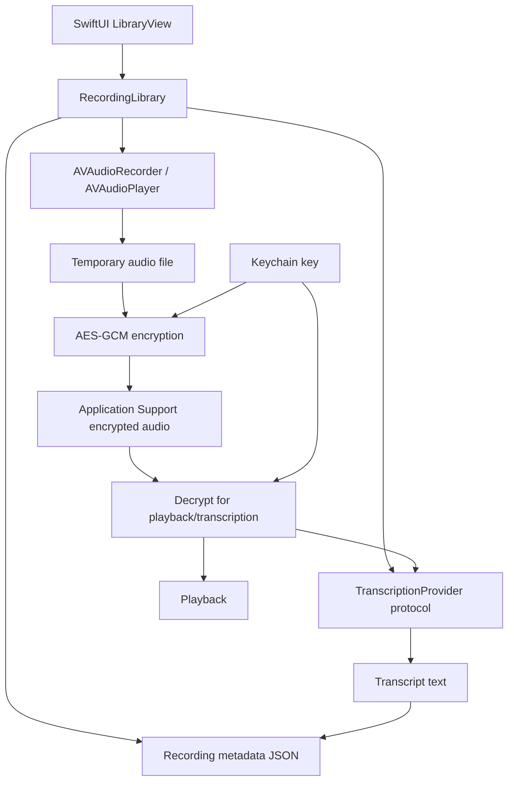

# Architecture

## Principles

1. **Local-first:** recording does not require a network connection.
2. **Explicit AI boundary:** the app calls a `TranscriptionProvider`; the default provider is unconfigured and never uploads audio.
3. **Small seams:** the recorder/library, encrypted file store, metadata model, and transcription provider have distinct responsibilities.
4. **Fail visibly:** permission, storage, encryption, and transcription failures are surfaced instead of silently pretending success.
5. **Minimize retention:** encrypted files are deleted on explicit user action; temporary plaintext playback files are removed during normal cleanup.

## Data flow

## Components

- `LibraryView`: primary interface, search, recording controls, status messages, and privacy disclosure.
- `RecordingLibrary`: main-actor orchestration, AVFoundation lifecycle, metadata persistence, playback and transcription calls.
- `VaultStore`: AES-GCM sealing/opening, protected file writes, Keychain key lookup, and deletion.
- `Recording`: Codable metadata record. The transcript is currently stored with metadata and therefore needs encryption before production use.
- `TranscriptionProvider`: dependency seam for on-device speech or an approved service. Provider behavior must disclose whether network access occurs.

## Failure semantics

- Denied microphone permission prevents recording and provides actionable text.
- A failed recording start does not switch the UI into recording state.
- A failed encryption attempt deletes the plaintext temporary recording and does not add a library entry.
- Missing/corrupt encrypted files produce an error rather than an empty playback result.
- An unconfigured transcription provider returns a typed, user-visible error.

## Next architecture iteration

For production, introduce protocols for audio capture, persistence, and clock access; inject a test vault directory and keychain namespace; use a transactional database for metadata; encrypt transcripts; make recording state an explicit enum; and implement interruption events and cancellation. Avoid storing plaintext audio in general-purpose temporary storage where a streaming encrypted sink is feasible.
